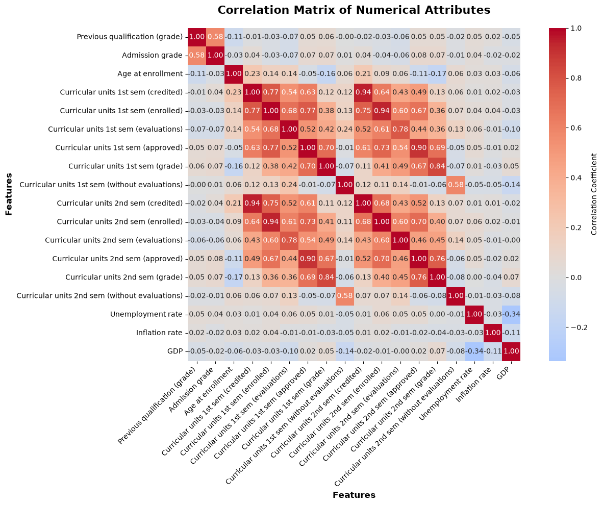
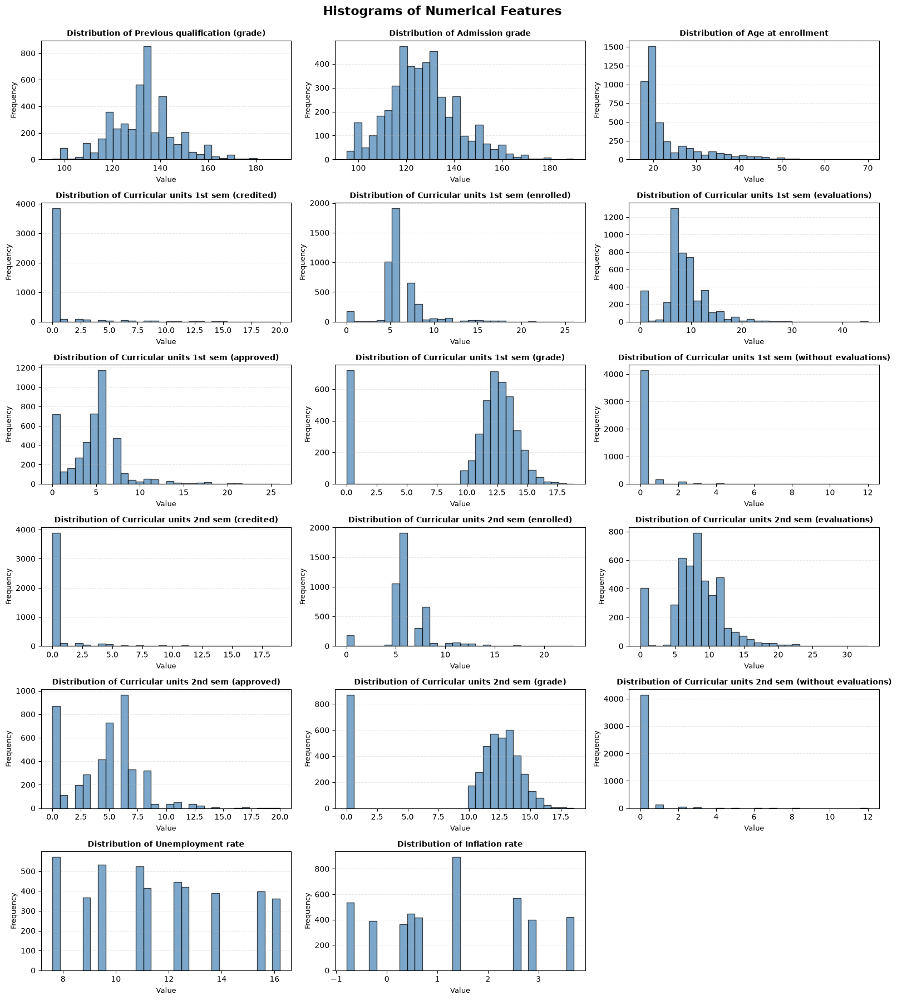

# Project Report
**Author**: Petter Gustafsson (pg222jw)   
**Course**: Advanced Information Visualization and Applications (4DT912)

## Dataset

### Introduction

The [**Students' Dropout and Academic Success**](https://archive.ics.uci.edu/dataset/697/predict+students+dropout+and+academic+success) dataset originates from the educational domain and provides insights into students' academic performance, dropout and graduation outcomes, demographics, and educational and socio-economic backgrounds. The dataset was supported by the SATDAP – Capacitação da Administração Pública program and is available through the [**UCI Machine Learning Repository**](https://archive.ics.uci.edu/), where it was originally used to develop and evaluate a classification model for predicting student dropout and academic success.

The dataset comprises more than 4,000 students, each described by 37 attributes, with no missing values. It follows a tabular structure in which each row represents an individual student and each column represents a student attribute. These attributes cover various aspects of students' backgrounds and academic circumstances, including marital status, course enrolment, attendance-related information, educational qualifications, nationality, parental education levels, and academic grades. The attributes encompass several data types, including numerical, nominal, ordinal, and binary variables.

### Analytical opportunities

Considering the available student attributes, users may be interested in exploring patterns and relationships between academic outcomes and various student characteristics, such as parental educational attainment, admission grades, and scholarship status. For instance, users might discover that students who graduate tend to have higher admission grades, come from families with higher parental educational attainment, and are more likely to receive scholarships than students who drop out.

Furthermore, users may be interested in investigating the extent to which different attributes are associated with academic outcomes. For example, admission grades might exhibit a strong association with graduation, whereas parental educational attainment might show a weaker relationship. Such insights could help users identify which student attributes are most strongly associated with different academic outcomes.

### Concerns

Some concerns include the semantics of certain attributes, including inflation and umemployment rate, and GDP. While these attributes are generally well-defined and widely understood concepts, their meaning in the context of attributes describing individual students is ambiguous. For instance, it is unclear what it means for a student to have an inflation rate of 2.8%. Consequently, any analyses involving dimensionality reduction methods that include these attributes should be interpreted with caution, as their relevance and meaning in the context of individual students are questionable. Excluding these attributes from such analyses should therefore be considered.

### Dataset characteristics

Figure 1 in *Appendix* presents the correlation matrix of the numerical attributes. The matrix reveals generally weak correlations between several attributes, whereas the curricular unit attributes tend to exhibit strong correlations with one another. For instance, the number of credited curricular units in the first semester is highly correlated with that of the second semester (0.94). This is likely due to the two features having similar value distributions across semesters, as illustrated by their histograms in Figure 2 in *Appendix*. Similar patterns can be observed among the attributes describing approved and enrolled curricular unit credits across the two semesters.

These findings suggest that removing one of the semesters for certain curricular unit attributes should be considered during future preprocessing. Retaining both semesters may introduce redundant information, as the corresponding features appear to capture largely similar patterns.

### Justification of suitability

The dataset is well-suited for dimensionality reduction and projection for several reasons. Most notably, it contains numerous (>10) numerical dimensions, including admission grades and various attributes describing curricular units, making it difficult to represent the data meaningfully in three dimensions or fewer.

Furthermore, the dataset contains many categorical features that can be used to encode data points in the reduced space, enabling the exploration of patterns across multiple dimensions. For instance, colouring students based on their academic outcomes, such as dropout or graduation status, may reveal distinct clusters or groupings associated with these outcomes.

Although some numerical attributes may be excluded during preprocessing, as discussed in the previous section, the dataset still offers considerable opportunities to incorporate categorical features. Techniques such as one-hot encoding can transform these features into numerical representations, allowing them to be included in the dimensionality reduction process and potentially enriching the resulting projections.

## Overall analytical goal

The overall analytical goal of the visual analytics interface is to enable users to discover patterns and potential associations between academic outcomes and multiple student attributes within a latent 2D space. This includes identifying distinct student profiles based on their positions and distributions in the latent space, as well as investigating how these profiles differ across various attributes, such as academic grades and parental educational attainment.

For instance, users might discover that students form distinct groups based on their academic outcomes, such as dropout and graduation status. Further examination of these profiles might reveal significant differences in admission grades between the groups. Such discoveries could help users identify potential associations between student characteristics and academic outcomes, as well as understand which attributes are most strongly associated with different outcomes.

Furthermore, users should be able to identify potential outliers that deviate from the identified student profiles in the latent space. This would allow users to inspect individual students and compare their characteristics with those of other student profiles across multiple attributes. For example, an outlier might represent a student with considerably higher admission grades than those typically observed within other profiles, or a student whose parents have particularly high levels of educational attainment.

These analytical tasks contribute to the overall analytical goal in several ways. Identifying student profiles based on categorical attributes, such as dropout and graduation status, facilitates pattern exploration by allowing users to visually identify potential groupings and distributions in the latent space. Subsequently, comparing these profiles across different student attributes enables users to investigate potential associations between academic outcomes and other student characteristics. Together, these capabilities support an exploratory approach to understanding the relationships between student characteristics and academic performance.

## Design implications

The design implications of the analytical goals and tasks outlined in the previous section include using a 2D coordinate system to visualize the latent space, serving as the primary visualization in the interface. This visualization can be complemented by interactions that allow users to select individual data points or groups of points using selection methods such as rectangular or lasso selection, triggering the display of supporting visualizations. These visualizations could, for instance, present summary statistics and distributions of numerical attributes, enabling users to compare different student profiles and investigate potential differences between them.

The supporting visualizations could be juxtaposed with the main visualization, allowing users to maintain multiple views of the data simultaneously and preserve the context of their exploration. This would facilitate comparisons between different selections without requiring users to repeatedly switch between visualizations or lose track of previously explored patterns.

# Disclosures

- AI has been used to improve grammar and semantics in this text.

# Appendix

